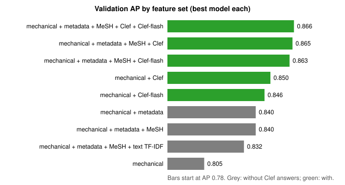
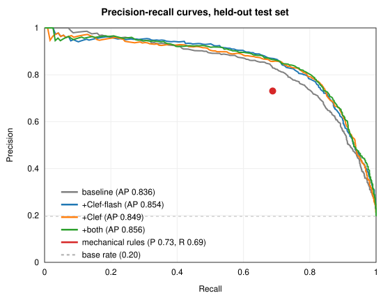
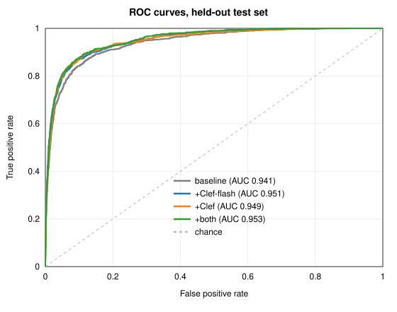
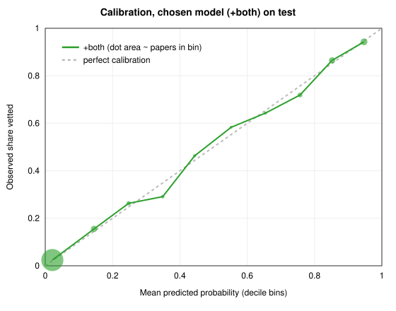

# Predicting the Research Team's vetted cancer-relevant publications

**Status:** pilot complete (2026-11). **Issues/PRs:** #54 (review tool), #55/#56 (consortium
matching), #57/#58 (vetted-evidence matching), #59/#60 (Clef pilot).
**Code:** `cancer_center/vetted_ml.py`, `cancer_center/axes.py`, `cancer_center/evidence.py`.
**Figures and result tables** in this folder are generated by `make_report_assets.py` (see
[Reproducing](#reproducing)).

**Where the numbers come from:**
- `results.json` (generated): every number in §4, plus the coverage, prevalence and P30
  counts in §1.3 and §3.1.
- Other numbers come from runs recorded elsewhere and are not regenerated by that script:
  - §1.1–1.2 (decoding and rule rates): the analysis in issue #54.
  - §2 (matching recall, suspect members, held-out matching test): PRs #56 and #58, and the
    build's vetted-recall report.
  - §3.2 (leaky-table AP): PR #60.
  - §3.3 (approximate feature counts): printed by the first experiment run.
  - §3.5 (crowding check, tokens, cost, timing): PR #60.
  - §5 (thresholds and counts): the output of `vetted_ml export` and the workbook's
    `summary` sheet.

## Summary

The UCCC Research Team hand-curates the Center's cancer-relevant publications each fiscal year.
Their FY2016–26 list (5,972 PMIDs) is the label set here. We asked how well that list can be
reproduced from data we already hold, and whether Cloudflare's Clef decision models add anything.

- **Member matching first.** Before scoring papers, the cohort has to contain them. Matching
  consortium members by ORCID across institutions and then by evidence from the vetted list
  raised recall of vetted (paper, member) pairs from 81.4% to 95.2%.
- **Mechanical rules** (membership at publication, original research, cancer terms) reach
  precision 0.73 / recall 0.69 on the held-out test set.
- **A gradient-boosted classifier** on mechanical, metadata and MeSH features reaches test
  AP 0.836 (AUC 0.941).
- **Adding Clef answers** (34 questions per paper) raises test AP to 0.856 (AUC 0.953;
  +0.020, 95% CI +0.008 to +0.032). Clef-flash alone gives +0.018 [+0.007, +0.029];
  Clef (27B) is not detectably better than Clef-flash and costs about six times more.
- **The gain is concentrated where the rules fail:** eligible papers with no cancer words
  (basic biology, cancer control). There, recall rises from 0.40 to 0.63 and precision from
  0.51 to 0.63.
- **Probabilities are well calibrated** (figure 4), so they can drive review bands directly.

## 1. Data

### 1.1 The vetted list

`data/external/PubsthruFY26_11.2.26.xlsx` (gitignored): one sheet, 5,972 unique PMIDs, report
years FY2016–26 (publication years 2015–2026), accepted papers only — there are no recorded
rejections. Columns decoded from the data:

| Column | Meaning | Evidence |
|---|---|---|
| `ReportYr` | Fiscal year July–June: published July or later counts toward the next year | matches 98.7% of rows |
| `Coding`, first token | Collaboration class: `0000` one member, `0001` intra-program, `0002` inter-program, `0003` both | 98% of `0000` rows have one member |
| `Coding`, `PPxx` tokens | Program (03 CCB, 04 CPC, 05 DT, 10 LHN, 11 HEME, 12 MCO, 13 THI) and class suffix | matches `Programs` |
| `Inst` | Member's institution: 9 UCD, 7 CU Boulder, 2 CSU, 5 NJH, 4 VA, 6 CHCO (likely) | joined to the roster |
| SR columns | Shared resources used or acknowledged | — |
| `0004`, `#` / `xx99`, `-25`/`-S`/`-R` | Not decoded | carried through as-is |

### 1.2 Rules the list encodes

From joining the list to our cohort (FY2016–25, before the matching fixes):

| Signal | Vetted rate |
|---|---|
| Member at publication vs before joining / after leaving | 31% vs 2% / 3% |
| Full or Mentored vs Affiliate, Associate, Clinical, Partner members | ~46–49% vs ≤5% |
| iCite research article vs not | 56% vs 5% |
| PubMed review / comment / editorial / letter / guideline / meta-analysis | 3% of vetted papers, but 63% of unvetted cancer papers |
| Cancer signal, among original research with a CU affiliation | 85% with vs 29% without |
| Cites the Center's P30 (CA046934), with a cancer signal | 96% |

Answers from the Center side (Sean, standing in for the team): excluding member types is a
tendency, not policy; a consortium affiliation on the byline is **not** required; members at
CSU, CU Boulder, NJH, Denver Health, the VA and UCHealth count like Anschutz members.

### 1.3 Other sources (cdsci-lake)

`omicidx.pubmed_article` (abstract, publication types, MeSH), `icite.metadata`
(`is_research_article`, `is_clinical`, human/animal/molecular scores), and `reporter.publink`
(P30 links). For papers in the experiment table, abstract coverage is 99.8%, MeSH 79.9% and
iCite 99.7%; 1,130 papers link to the P30.

## 2. Cohort construction (member matching)

A paper can only be scored if it is attributed to a member. Matching changes, measured as recall
of vetted (PMID, member) pairs (9,380 pairs):

| Step | Recall | Suspect members* |
|---|---|---|
| Original matching (Anschutz author pool, ORCID + name) | 81.4% | 64 |
| + ORCID lookup across all institutions, split profiles, consortium home institutions (#56) | 87.7% | 38 |
| + vetted-evidence tier (#58) | 95.2% | 2 |

\*≥5 vetted pairs and recall below 50%.

The vetted-evidence tier links an author to a member when the author's name fits the member on
at least two of the member's vetted papers. Ambiguous authorships are skipped, ORCID-owned
profiles are reserved, and ties give the author to nobody. On a held-out test (evidence from
FY2016–24 only, scored on FY2025–26), recall went from 85.5% to 87.5%. That is the honest
gain for new papers; the in-sample figure is circular.

## 3. Methods

### 3.1 Universe, labels and split

- **Universe:** cohort papers with a PMID published in FY2016–26.
- **Label:** whether the PMID is on the vetted list (20.3% positive).
- **Split:** fixed 60/20/20, assigned by `sha256(seed:PMID)` with seed 20261102, so it doesn't
  move when the table is rebuilt (`vetted_ml.split_of`). A member's papers appear in every
  split.
- **Protocol:**
  - Vocabularies, TF-IDF and scaling are fit on train only.
  - Feature set, model type, hyperparameter and decision threshold (max F1) are chosen on
    validation.
  - Test is evaluated once, for the configuration chosen on validation.

### 3.2 Leakage control

In production, the vetted-evidence matching (§2) uses the whole list, so held-out labels would
shape which papers are in the cohort and how they are attributed. All numbers below come from a
**leakage-clean table**: member matching rebuilt with evidence from **train-split papers only**
(`extra_authors --evidence-split train`), then `build`, then
`vetted_ml build --table vetted_ml_table_trainev`. This contains 27,743 papers: 16,658 train,
5,531 validation and 5,554 test (1,089 of them vetted). The leak turned out to be small: the
baseline test AP was 0.837 on the leaky table and 0.836 on the clean one.

### 3.3 Features

| Group | Contents |
|---|---|
| **G0 mechanical** (21) | Member at publication; Full/Mentored type in effect at publication (the roster's current type, counted from its start date); iCite research article, clinical, human, animal and molecular scores, and a missing flag; excluded PubMed type; cancer terms in OpenAlex topic/title, MeSH and abstract; P30 link; intra-/inter-program and external collaboration; open access; log author count; member and program counts; no-abstract flag |
| **G1 metadata** (~950) | PubMed publication types, member programs, OpenAlex field and subfield, journal (min. 5 papers in train) |
| **G2 MeSH** (~1,500) | Main MeSH descriptors (min. 15 papers in train) |
| **G3 text** (~58,000) | Title + abstract TF-IDF, 1–2-grams |
| **AX Clef** (70 per model) | Probability of every option of every question in question set v1 (§3.5), plus a missing flag |

### 3.4 Models

- **Gradient-boosted trees** (scikit-learn `HistGradientBoostingClassifier`, learning rate 0.05
  or 0.1, up to 400 iterations, early stopping). Not run on G3, which is too wide for dense
  trees.
- **L2 logistic regression** (C 0.1 or 0.3; numeric G0 standardized).
- The model outputs a class probability, P(on the vetted list).

### 3.5 Clef decision-model features

- **Models:** Cloudflare's [Clef](https://developers.cloudflare.com/workers-ai/models/clef/)
  (27B) and Clef-flash (9B), on Workers AI. Each call takes a *state* and up to 64 typed
  questions (`noul` yes/no, `choice`, `score`) and returns a probability for every option in a
  single pass, with no generated text.
- **State:** title, journal, PubMed abstract and MeSH headings.
- **Question set v1:** 34 questions, frozen by a test; edits must go into a new version. The
  full text is in [`questions_v1.md`](questions_v1.md), generated from `axes.V1`. Groups:
  - how central cancer is (0–3) and "would an NCI cancer center count this";
  - whether it studies a cancer-driving process, and whether it is cancer prevention/control;
  - 13 biology processes and 9 cancer-control and clinical stages;
  - study system, organism, disease focus and cancer site;
  - fit with each of the four current programs (CPC, DT, MCO, THI), using their published aims.
- **Wording loop:** on a 500-paper slice of train only.
- **Crowding check:** the four core questions answer the same alone and inside the 34-question
  set (correlation 0.98–1.00), so long sets are safe.
- **Cost and time for all papers:** about 4,450 input tokens per call.

  | Model | Price | Input tokens | Cost | Wall time |
  |---|---|---|---|---|
  | Clef-flash | $0.038 / M input | 125.7M | $4.80 | 46 min |
  | Clef | $0.24 / M input | 125.7M | $30.18 | 16 min |

  Output tokens are free.

**Strongest single questions** (Clef-flash, AUC on train against the vetted label):

| Strongest | AUC | Weakest / negative | AUC |
|---|---|---|---|
| `nci_counts` | 0.789 | `cancer_focus=0` (not about cancer) | 0.223 |
| `disease_focus=cancer` | 0.770 | `cancer_site=none` | 0.258 |
| `cancer_focus=3` (main subject) | 0.767 | `disease_focus=other` | 0.264 |
| `cancer_focus=2` (model/context) | 0.744 | `study_system=review` | 0.339 |
| `cancer_control` | 0.696 | `study_system=qualitative` | 0.349 |
| `cc_treatment` | 0.690 | `disease_focus=immune` | 0.357 |

## 4. Results

### 4.1 Feature-set comparison (validation)



*Figure 1. Validation average precision (AP) for the best model in each feature set. Grey bars
have no Clef answers; green bars include them.*

Observations:
- Metadata (mostly journal) and MeSH add little beyond the mechanical features: 0.805 → 0.840.
- Raw text does not help (0.832).
- Clef answers on top of mechanical features alone (0.846–0.850) already beat the best
  non-Clef set.
- The full Clef combination reaches 0.866.

### 4.2 Held-out test set

| Model (threshold chosen on validation) | AUC | AP | Precision | Recall | F1 |
|---|---|---|---|---|---|
| Mechanical rules (no model) | — | — | 0.731 | 0.688 | 0.709 |
| Baseline: mechanical + metadata + MeSH | 0.941 | 0.836 | 0.775 | 0.758 | 0.766 |
| + Clef-flash | 0.951 | 0.854 | 0.825 | 0.749 | 0.785 |
| + Clef | 0.949 | 0.849 | 0.810 | 0.782 | 0.796 |
| **+ both (chosen on validation)** | **0.953** | **0.856** | **0.800** | **0.803** | **0.802** |

*Table. Test set: n = 5,554, of which 1,089 vetted.*

Paired bootstrap of the AP difference on the same test papers (2,000 resamples):

| Comparison | AP gain | 95% CI |
|---|---|---|
| + Clef-flash vs baseline | +0.018 | +0.007 to +0.029 |
| + Clef vs baseline | +0.013 | +0.002 to +0.024 |
| + both vs baseline | +0.020 | +0.008 to +0.032 |
| Clef vs Clef-flash | −0.005 | −0.012 to +0.002 |
| + both vs + Clef-flash | +0.002 | −0.003 to +0.006 |

These intervals are conditional on the fitted models; they don't include training or
model-selection uncertainty.



*Figure 2. Precision-recall curves on the test set. The red dot is the mechanical rule cascade,
a single operating point; the dashed line is the base rate.*



*Figure 3. ROC curves on the test set. The dashed diagonal is chance.*

### 4.3 Where the gain comes from

**Hard slice:** eligible papers (member at publication, Full/Mentored, original research) with
**no cancer terms** in topic, title, MeSH or abstract. Test n = 988, of which 166 vetted.

| Model | Precision | Recall |
|---|---|---|
| Baseline | 0.511 | 0.404 |
| + Clef-flash | 0.678 | 0.494 |
| + both | 0.629 | 0.633 |

**Per current program** (a paper counts toward every program of its attributed members):

| Program | Test n (vetted) | Baseline P / R | + Clef-flash P / R | + both P / R |
|---|---|---|---|---|
| Cancer Prevention & Control | 2,206 (353) | 0.77 / 0.69 | 0.80 / 0.69 | 0.77 / 0.74 |
| Developmental Therapeutics | 1,493 (478) | 0.83 / 0.87 | 0.89 / 0.85 | 0.87 / 0.89 |
| Molecular & Cellular Oncology | 970 (281) | 0.77 / 0.75 | 0.83 / 0.79 | 0.81 / 0.84 |
| Tumor-Host Interactions | 1,101 (284) | 0.79 / 0.81 | 0.83 / 0.78 | 0.80 / 0.82 |

### 4.4 Calibration



*Figure 4. Observed share of vetted papers vs mean predicted probability, by decile of
prediction, for the chosen model on test. Dot area is proportional to the number of papers in
the bin; the dashed diagonal is perfect calibration.*

## 5. Final model and the review workbook

**Model:**
- Gradient-boosted trees (learning rate 0.05) on G0 + G1 + G2 + Clef-flash v1 + Clef v1.
- For a cheaper production path, drop Clef. Clef-flash alone is not detectably worse than
  the chosen model: +both vs +Clef-flash is +0.002 AP, 95% CI −0.003 to +0.006.

**Scoring the whole cohort** (`vetted_ml export`):
- Every paper gets an **out-of-fold** probability. In 5-fold stratified cross-validation,
  each paper is scored by a model trained on the other four folds.
- The attribution leak (§3.2) still applies to these production scores, because matching uses
  the whole list. The out-of-fold scores are also well calibrated (workbook `calibration`
  sheet).

**Bands** (thresholds set on the out-of-fold scores):

| Band | Rule | Papers |
|---|---|---|
| 1 propose | precision ≥ 90% (probability ≥ 0.783) | 3,625 |
| 2 needs judgment | in between | 11,433 |
| 3 held back | below the score that keeps 98% of vetted papers above it (probability < 0.021) | 13,193 |

`model_says_yes` uses the max-F1 cut-off, probability ≥ 0.442.

**Workbook** (`data/cancer_center/exports/vetted_review_FY16-26_2026-11-02.xlsx`; internal, contains member names):
- **`papers` sheet:** one row per PMID, our cohort full-outer-joined to the team's sheet.
  28,550 rows × 119 columns: our features, the readable Clef-flash answers (`clef: *`), the
  model probability and band, and all 40 team columns (`team: *`).
- **Filter columns:** `in_team_list`, `in_our_cohort`, `model_band`, and `agreement`:

  | `agreement` | Papers |
  |---|---|
  | both yes | 4,449 |
  | team only: model said no | 1,224 |
  | team only: not in our cohort | 299 |
  | model only: possible team miss | 997 |
  | neither | 21,581 |

- **Other sheets:** `summary`, `calibration` and `README`.

## 6. Limitations

- **Random split by paper.** A member's papers fall in every split, so the model can learn
  member and journal habits. A split by year would likely score lower; the vetted rate also
  drifts down in FY2024–26.
- **Possible label noise (hypothesis, not yet checked).** The list records only acceptances,
  so some "negatives" may be papers the team missed; many high-scoring unvetted papers look
  like cancer research. If so, precision against the list has a ceiling, which could explain
  part of the plateau near 0.87 AP. Nobody has checked these papers yet.
- **Attribution.** About 300 vetted PMIDs are not in the cohort (`team only: not in our
  cohort`). The production scores carry the attribution leak described in §3.2.
- **Member type.** The roster holds only each member's current type. Papers published before
  that type's start date get an unknown type.
- **Clef-flash's hosted context is 24k tokens.** Title + abstract + MeSH is far below that,
  but full text would need Clef.

## 7. Next steps

1. **Have the team review the `model only: possible team miss` rows** (997, highest
   probability first). Their verdicts improve label quality and test the label-noise
   hypothesis. They won't necessarily raise every metric: the effect depends on where the
   corrected papers score.
2. **Question set v2 aimed at the hard slice.** Add the member's own program to the state and
   ask sharper basic-biology questions. Develop on a train slice and compare on validation.
3. **#54 Phase 6:** the spreadsheet round-trip pilot, using this workbook's layout.

## Reproducing

```bash
# member matching + cohort (production: evidence from the whole list)
uv run python -m cu_openalex.cancer_center.extra_authors
CU_OPENALEX_LAKE_BACKEND=postgres uv run --extra lake python -m cu_openalex.cancer_center.build --no-bake
# leakage-clean experiment table (then restore production with the two commands above)
uv run python -m cu_openalex.cancer_center.extra_authors --evidence-split train
CU_OPENALEX_LAKE_BACKEND=postgres uv run --extra lake python -m cu_openalex.cancer_center.build --no-bake
CU_OPENALEX_LAKE_BACKEND=postgres uv run --extra lake --extra ml python -m cu_openalex.cancer_center.vetted_ml build --table vetted_ml_table_trainev
# Clef answers (cached and resumable; needs CLOUDFLARE_ACCOUNT_ID + CLOUDFLARE_API_TOKEN)
uv run python -m cu_openalex.cancer_center.axes --model clef-flash --version v1 --table vetted_ml_table_trainev
uv run python -m cu_openalex.cancer_center.axes --model clef --version v1 --table vetted_ml_table_trainev
# experiment, figures, and the review workbook
uv run --extra ml python -m cu_openalex.cancer_center.vetted_ml run --table vetted_ml_table_trainev --axes clef-flash:v1 clef:v1 --out data/cancer_center/vetted_ml/val_trainev.parquet
uv run --extra ml python docs/vetted_classifier/make_report_assets.py
uv run --extra ml python -m cu_openalex.cancer_center.vetted_ml export --out data/cancer_center/exports/vetted_review.xlsx
```
